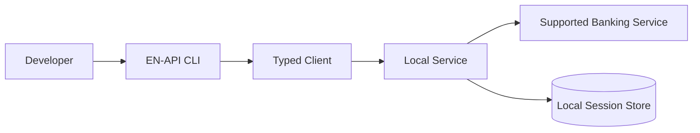

<div align="center">


# EN-API

### A developer-focused interface for supported banking workflows.

[](https://www.typescriptlang.org/)
[](https://nodejs.org/)

</div>

---

## Overview

**EN-API** is a TypeScript-based project that provides a developer interface for interacting with supported banking workflows. It brings client-side tooling and local service components together in a consistent workflow.

> This README is a presentation redesign. Verify commands, endpoint names, configuration keys, and security behavior against the current source code before relying on them operationally.

## Highlights

- **Typed developer experience** — TypeScript-oriented interfaces and structured data handling.
- **Local service workflow** — a local API/service layer for supported operations.
- **Session handling** — session persistence and recovery where implemented.
- **Security-conscious design** — sensitive authentication material should remain protected.
- **CLI workflow** — command-line access to supported project operations.

## Architecture



*Conceptual architecture; update this diagram if the implementation differs.*

## Getting Started

### Requirements

- Node.js version supported by the repository
- npm
- Any credentials required by the supported banking service

### Installation

```bash
git clone https://github.com/iaMaSTeR-Dev/EN-API.git
cd EN-API
npm install
```

### Configuration

Create the configuration file expected by the application. Never commit real credentials, cookies, access tokens, or session files.

```env
# Add only variables documented by the project.
# Do not put real credentials in this file.
```

### Run

Inspect the available scripts:

```bash
npm run
```

Then run the appropriate development, build, or CLI script listed by the repository. Exact script names are intentionally not guessed.

## Security

- Treat session files and authentication material as secrets.
- Keep local service interfaces bound to loopback unless remote access is explicitly required and secured.
- Do not expose a local daemon directly to the public internet.
- Redact tokens, account identifiers, and personal data from logs and bug reports.
- Use the project only with accounts and services you are authorized to access.

## Troubleshooting

| Symptom | Checks |
|---|---|
| Authentication fails | Verify the supported login/session flow and check whether credentials have expired. |
| Local service is unreachable | Check the configured host/port and confirm the service is running. |
| Session is not restored | Check local file permissions and the configured session path. |
| Runtime or dependency errors | Use the Node.js version expected by the repository and reinstall dependencies. |

## Contributing

Issues and pull requests are welcome.

1. Check existing issues before opening a new one.
2. Keep changes focused and include relevant tests.
3. Never commit real credentials, session data, or private account information.
4. Document behavior and configuration changes in pull requests.

## License

See the repository's `LICENSE` file. If no license file is present, clarify the project's reuse terms with its maintainers before redistribution.

---

<div align="center">

**EN-API** · Built for developers

</div>
