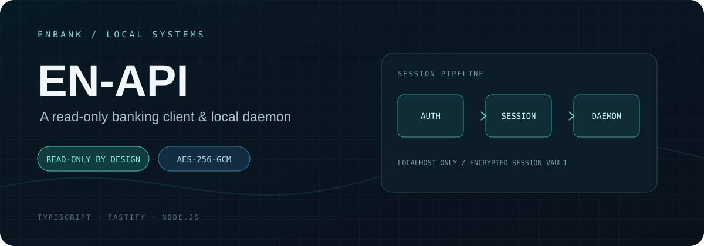
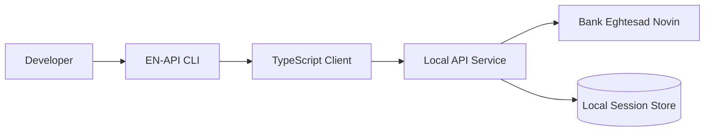

 <div align="center">



# EN-API

### Unofficial Banking API for Bank Eghtesad Novin

**A TypeScript-based developer interface for Bank Eghtesad Novin (EN Bank) — Iran.**

**رابط برنامه‌نویسی غیررسمی بانک اقتصاد نوین ایران**

[](https://www.typescriptlang.org/)
[](https://nodejs.org/)


</div>

---

## Overview

**EN-API** is an open-source, TypeScript-based project designed to provide developers with a programmable interface to **Bank Eghtesad Novin (بانک اقتصاد نوین)** banking services in Iran.

The project integrates with the bank's **Hamrah Novin (همراه نوین)** digital banking platform, bringing supported banking workflows into a developer-friendly environment through typed interfaces, local service components, and command-line tooling.

It aims to simplify banking integrations, automation, and application development without requiring developers to interact directly with the bank's web interface.

> **Disclaimer:** EN-API is an independent, unofficial project and is not affiliated with, endorsed by, or maintained by Bank Eghtesad Novin.

## Highlights

- **Bank Eghtesad Novin Integration** — developer-oriented access to supported Hamrah Novin banking workflows.
- **TypeScript Support** — typed interfaces and structured data handling.
- **Local API Service** — local service components for integrating banking functionality into applications.
- **Session Management** — authentication session handling and recovery where supported.
- **CLI Tools** — command-line access to implemented banking operations.
- **Security-Conscious Design** — guidance for protecting credentials, tokens, and sensitive banking data.

## Architecture



*Conceptual architecture of the EN-API integration workflow.*

## Getting Started

### Requirements

- Node.js version supported by the repository
- npm
- Access to Bank Eghtesad Novin's supported banking services
- Valid banking credentials where authentication is required

### Installation

```bash
git clone https://github.com/iaMaSTeR-Dev/EN-API.git
cd EN-API
npm install
```

### Configuration

Configure the application according to the environment variables and authentication requirements defined in the repository.

Never commit real banking credentials, session files, cookies, or access tokens.

### Run

List available scripts:

```bash
npm run
```

Run the appropriate application, development, or CLI command defined in `package.json`.

## Security

Banking integrations involve sensitive financial information. Always follow appropriate security practices.

- Protect banking credentials, authentication tokens, and session data.
- Keep local API services accessible only to trusted applications.
- Never expose authentication endpoints directly to the public internet without appropriate security controls.
- Avoid logging sensitive financial or personal information.
- Use EN-API only with accounts and banking services you are authorized to access.

## Troubleshooting

| Issue | Suggested Check |
|---|---|
| Authentication failure | Verify banking credentials and the supported authentication workflow. |
| API service unavailable | Confirm that the local service is running and check its host/port configuration. |
| Session restoration failure | Check session storage permissions and authentication state. |
| Banking service errors | Check whether the Hamrah Novin platform is accessible or has changed. |
| Dependency errors | Verify the required Node.js version and reinstall dependencies. |

## Contributing

Contributions, bug reports, and feature requests are welcome.

1. Check existing issues before submitting a new one.
2. Keep pull requests focused and clearly documented.
3. Include relevant tests when changing functionality.
4. Never include real banking credentials, session data, or personal financial information.
5. Document newly supported banking operations and configuration changes.

## Disclaimer

EN-API is an **unofficial, independently developed integration** for Bank Eghtesad Novin.

This project is not affiliated with Bank Eghtesad Novin or its official banking platforms. Banking services, authentication mechanisms, and available functionality may change without notice.

Users are responsible for ensuring that their use of this project complies with applicable laws, banking terms, and security requirements.

## License

See the repository's `LICENSE` file for licensing information.

---

<div align="center">

**EN-API** · Unofficial Bank Eghtesad Novin Developer API

Made for developers, by developers.

</div>
